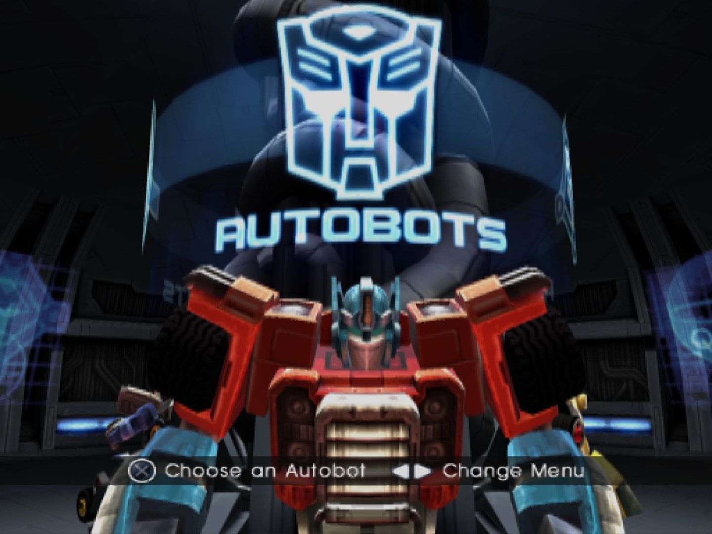
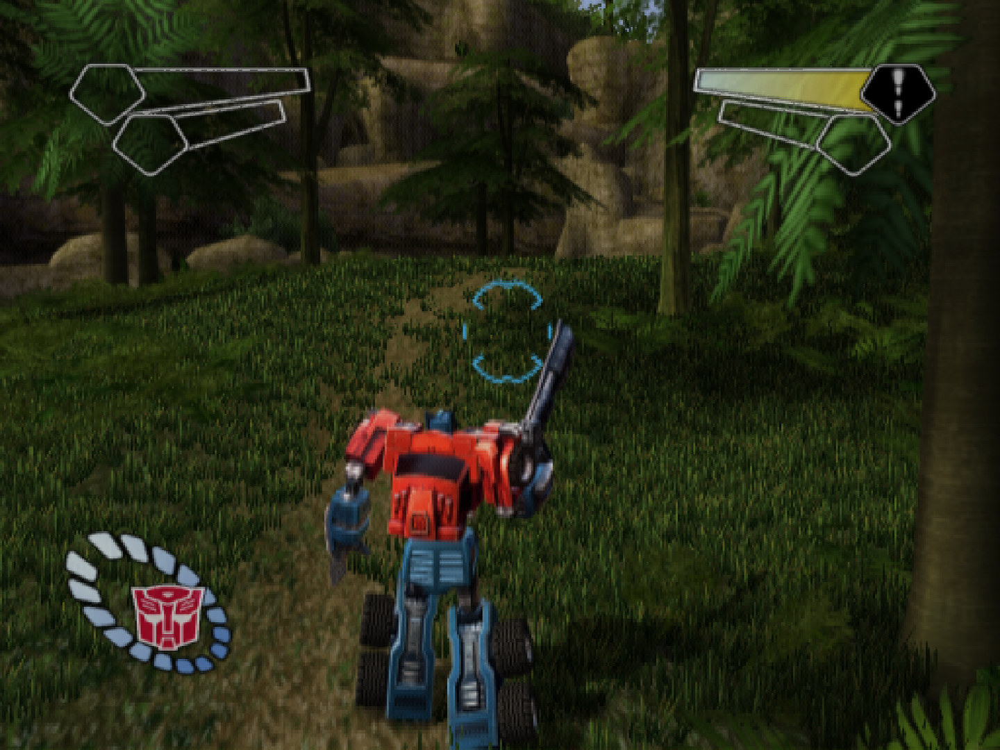
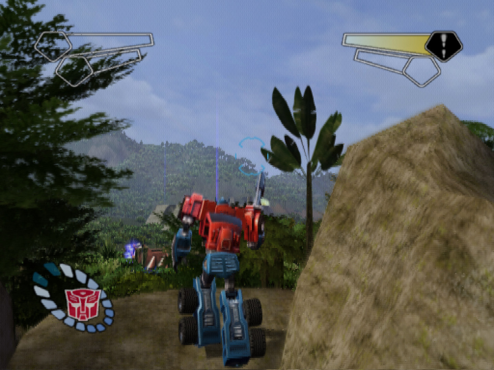
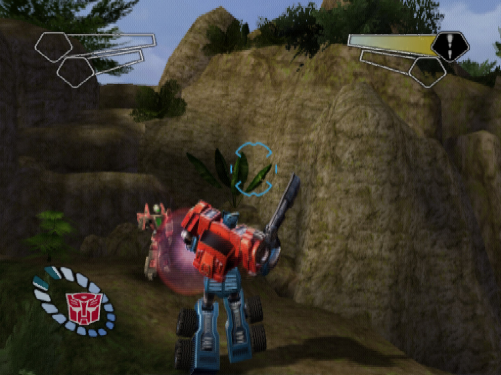
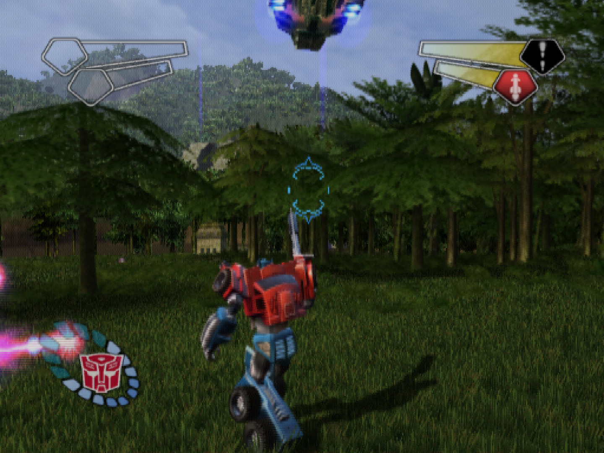
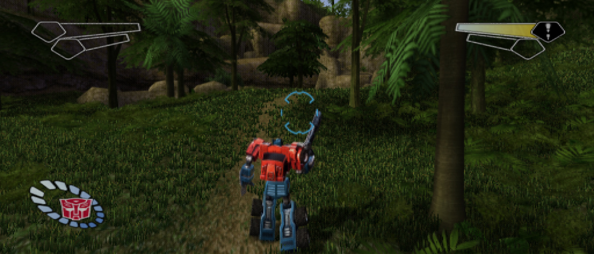
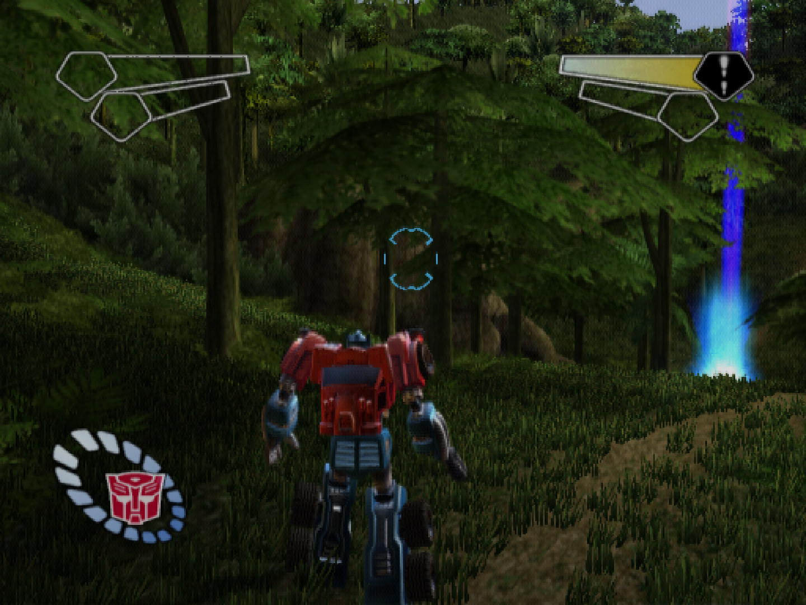
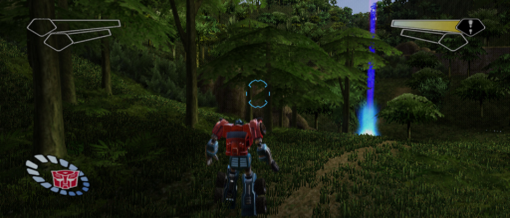
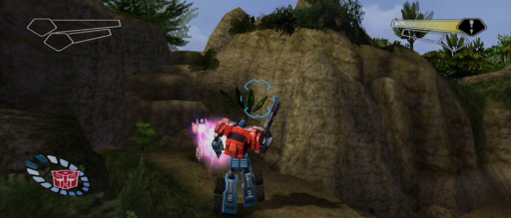

  

<h1 align="center">Transformers Armada PS2 Mods</h1>

  
  
  
  
  

  The home for mods and cheats for the decompiled version of <i>Transformers</i> on the PlayStation 2
  (Atari / Melbourne House, 2004), released in North America as <i>Transformers Armada: Prelude to Energon</i>.

---

## A note before you read on

This project is made with the help of AI, and I want to be upfront about that.

Transformers on the PS2 is a game I grew up with. It means a lot to me, and I know I am not the only one who still
thinks about it. This repository exists because of that love for the game and the nostalgia that comes with it.

Everything here comes from studying the game's own code. AI does the heavy lifting, but nothing is accepted on its
word: every cheat code says whether it was tried in the game or only read from the code, and the decompilation is
checked byte for byte against the original.

If you see AI-assisted work as "AI slop" or "vibe coded", I respect that, and this project is simply not for you.
No hard feelings. To everyone else who loves this game as much as I do: welcome, and thank you for being here.

## Where is the decompilation?

**The decompilation is still in progress.** It now happens in a separate repository, together with another
developer, and that repository stays private until it is ready. When it goes public, this page will link to it.

If you came here from the Reddit post: the work did not stop, it moved.

## Cheats

The game has **32 built-in cheat codes**, entered on the difficulty screen, in the Extras menu, at the HQ and in the
pause menu. All 32 are decoded from the game's own code table, with what each one does, in
**[docs/CHEATS.md](docs/CHEATS.md)**.

Some highlights:

| Where | Code | What it does | How we know |
|---|---|---|---|
| Difficulty screen | L1, R1, L2, R2, Left, Left, Right, Square | Start at the Volcano warp gate on Pacific Island, just before the boss | tried in the game |
| Difficulty screen | R2, R2, L1, L2, R2, R1, L2, L2 | Everything: every level including Cybertron, every Mini-Con | read from the code |
| HQ | L1, L2, Circle, Circle, Square, Circle, L2, L1 | Unlock all Mini-Cons | publicly known |
| HQ | Circle, Circle, Circle, Square, L1, L1, L1, L2 | Big head mode | publicly known |
| HQ | L1, R2, R2, Square, Square, Square, Square, L1 | Turbo mode | publicly known |
| Pause menu | R1, Circle, Circle, R1, R2, L1, L1, L2 | Invincibility (enter it again in each level) | publicly known |
| Pause menu | Left, Right, Left, R1, R2, R1, Right, Right | Enemies invisible | publicly known |

**All 32 codes are identified.** If one does more than the list says, open an issue.

## Mods

Mods here are made for the **decompiled version** of the game: the PC version that will be built from the
decompilation. Versions for the recompiled build or for PS2 emulators are not planned, unless many people ask for them.
Every mod is optional and off by default, so the original game always stays one step away.

| Mod | Status |
|---|---|
| 🖼️ **Ultrawide** (16:9, 21:9, 32:9) with the HUD at the screen edges | Shown in the screenshots below; comes with the decompiled version |
| 🔭 **HD and 4K** rendering | Shown in the screenshots below; comes with the decompiled version |
| 🛠️ **Hidden options** from the game's own config file: god mode, level select, warp gate transitions | Tested in the game; comes as a mod |
| 🎲 **20 more mods**, from an enemy randomizer to boss rush, photo mode and play as a Decepticon | Planned: **[docs/MODS.md](docs/MODS.md)** |

**Installing:** nothing is ready to download yet. The first mods will come with instructions here.

## Screenshots

Captured from a recompiled version of the game, rendered at a higher internal resolution than the PS2: a preview of
what the mods will bring to the decompiled version.

### 4:3, as on the PS2

<table>
  <tr>
    <td></td>
    <td></td>
  </tr>
  <tr>
    <td></td>
    <td></td>
  </tr>
</table>

### Ultrawide (21:9)

The same moments in 4:3 and 21:9. The wider screen shows more of the world at the sides instead of cutting off the top
and bottom, and the HUD moves out to the screen edges.

<table>
  <tr>
    <th>4:3</th>
    <th>21:9</th>
  </tr>
  <tr>
    <td width="36%"></td>
    <td width="64%"></td>
  </tr>
  <tr>
    <td width="36%"></td>
    <td width="64%"></td>
  </tr>
</table>

  

## Roadmap

| When | What |
|---|---|
| **Now** | All 32 cheat codes documented; the decompilation in progress |
| **Next** | The decompilation finished and public, and a native PC version built from it |
| **Then** | The first mods for it: ultrawide, HD rendering and the hidden options |
| **Later** | A mod loader and the 20 planned mods |

## No game data

This repository does not and will not contain game data: no disc images, executables, BIOS files or extracted
assets. You need your own copy of the game.

## Legal

This is an unofficial fan project for preservation and research. It is not affiliated with or endorsed by Hasbro,
Atari or Melbourne House. Transformers is a trademark of Hasbro. Screenshots are captured from the game for illustration.
